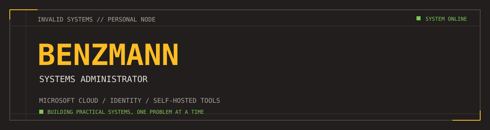

	
	
<strong>SYSTEMS ADMINISTRATOR / MICROSOFT CLOUD / PRACTICAL TOOLS</strong>

## // SYSTEM PROFILE

IT professional with 20+ years of experience across systems administration, Microsoft cloud, identity, and infrastructure. I like making complex systems easier to operate and building tools that solve problems I meet in real-world work.

## // FEATURED PROJECT

### [DarkMX](https://darkmx.is) - Domain diagnostics

**Check a domain. Find the problem.**

DNS, email authentication, TLS, and web security checks in one place, with results designed to explain what happened and what to do next.

## // OPERATIONAL FOCUS

- **Cloud and identity:** Microsoft 365, Entra ID, Active Directory, and SSO
- **Infrastructure:** servers, networking, DNS, and troubleshooting
- **Self-hosted systems:** Docker services and maintainable deployments
- **Email and web security:** practical diagnostics for configuration and delivery

## // BUILD PRINCIPLE

Useful tools should do more than report pass or fail. They should make the result clear, explain why it matters, and point to the next check.

---

`SIGNAL: BUILDING PRACTICAL TOOLS, ONE PROBLEM AT A TIME.`
